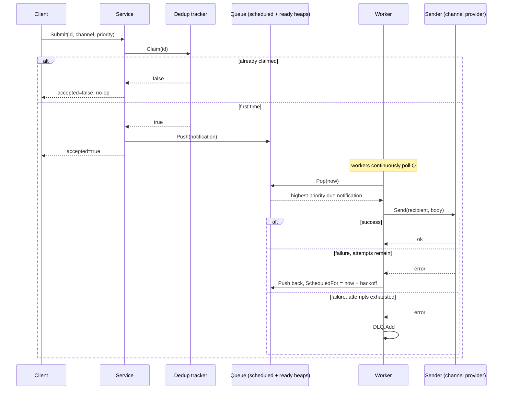
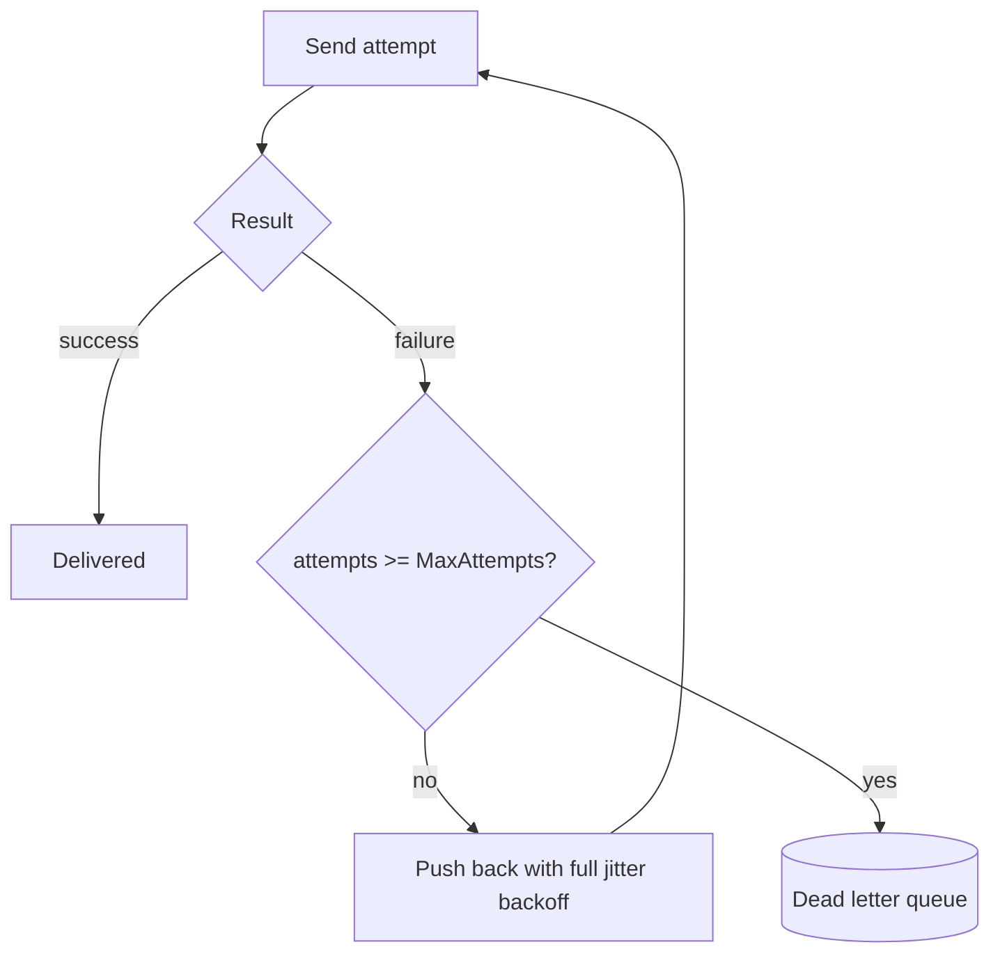

# Architecture

## Submitting and delivering

## Why two heaps

A single heap can only be ordered one way. This queue genuinely needs both orderings at once: a notification scheduled for an hour from now has to wait regardless of its priority, and among everything actually due right now, priority has to win regardless of submission order. See TestQueue_ReadyLowerPriorityBeatsNotYetDueHigherPriority for the case that only passes with two heaps.

## Retry, backoff, and the DLQ

Full jitter, the same formula as labs/retries-backoff, a fresh implementation here rather than a shared import. Every lab and system in this repository stays independently buildable on its own; see that lab's README for why fixed delays synchronize into a retry storm and jitter doesn't.
