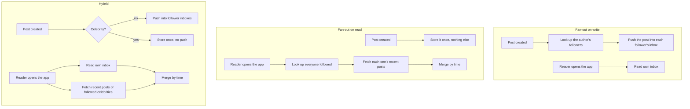
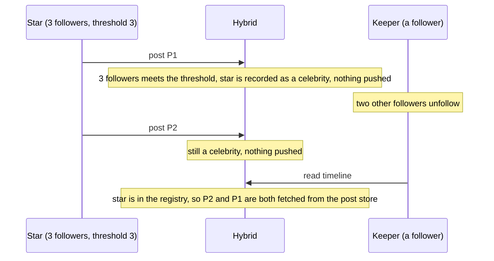

# Architecture

## Three ways to build a timeline

Each one decides where the work happens. None of them changes what a reader sees: given the same follows and the same posts, all three return the same timeline, which `TestStrategiesReturnTheSameTimeline` checks across 40 users and 300 posts.

## Where the cost lands

| | Cost of one post | Cost of one timeline read |
|---|---|---|
| Fan-out on write | one inbox write per follower of the author | one bounded read of the reader's own inbox |
| Fan-out on read | one store write | one lookup per followed account, plus a merge |
| Hybrid | one inbox write per follower, unless the author is a celebrity, then none | an inbox read, plus a scan of the followee list for celebrities, plus a merge with each celebrity's recent posts |

## The celebrity rule, and why it is sticky

An author is a celebrity once they have at least `CelebrityThreshold` followers at the moment they post. After that they stay one, even if followers later leave.

Recomputing celebrity status from the current follower count at read time would drop P1 as soon as the count fell below the threshold: it was never pushed into any inbox, and star would no longer be merged at read time. `TestHybrid_CelebrityStatusIsSticky` fails if that is changed, which was confirmed by changing it.

Crossing the threshold in the other direction needs no special handling. Posts made while the author was ordinary were pushed into inboxes. Posts made after are fetched at read time. A reader can see the same post from both sources, and the merge emits each post once.

## The inbox

Each inbox is a slice kept oldest first, allowed to grow to twice its bound before being trimmed back to the newest entries. That makes a push amortized constant time: one copy of the bound's worth of entries per bound's worth of pushes, instead of a copy on every push that prepending to a slice would cost. A cost model where fanning out to one follower is one cheap write is the honest one, and it is the one a real timeline store, a list with a trim, has. Inboxes are spread across 64 shards, each with its own lock, so fanning one post out to many followers does not queue every write behind one mutex.

An inbox is ordered by the order posts arrived in it, not by when they were created. Two posts created within microseconds of each other by different authors can land in a follower's inbox in either order, and a reader would see them in that order. It is not data loss, and the merge across sources still orders by creation time and sequence number, but it is a real property of this design.
